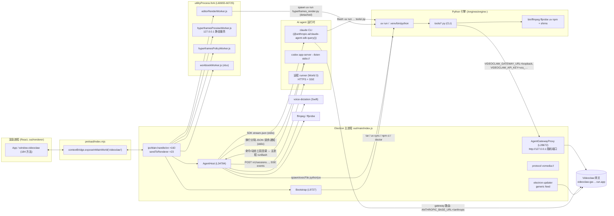

# 05 · 进程与架构边界

> 行号均指 `app/reconstructed/main/index.js`（除非注明）。**verified** = 直接读到代码；**inferred** = 由命名/上下文推断。

## 0. 一句话结论（verified）

**Python 引擎不是常驻服务，也没有 JSON-RPC/HTTP 服务端。** 它是一组 CLI 脚本（`<engine>/tools/*.py`），由三类调用方按需拉起：
1. **AI agent 本身**（Claude Code CLI 或 Codex app-server）在其 Bash 工具里执行
   `uv run --project "$VIDEOCLAW_ENGINE" python "$VIDEOCLAW_ENGINE/tools/<tool>.py" --job <bare-id>`
   （`ENGINE_TOOL_LAUNCHER`，L840；写进工作区 CLAUDE.md 的"执行契约"，L9572-9585）；
2. **Electron 主进程**直接 `spawn/execFile` 引擎 venv 的 python 或 `uv run`（计价、守卫、doctor、索引、角色图、渲染等）；
3. **编辑器渲染 utility 进程**（`editorRenderWorker.js`）执行 `uv run python tools/hyperframes_render.py --job <id>`。

通信方式一律是 **argv + env 输入，stdout（多为 `--json` 一次性 JSON 或逐行文本）+ 退出码输出**，个别脚本经 stdin 收 JSON。引擎访问云端网关时，`VIDEOCLAW_GATEWAY_URL` 指向主进程内的 **loopback HTTP 代理**（`AgentGatewayProxy`，127.0.0.1 随机端口），携带会话级一次性 token `vcs_<64hex>`，由代理换成真实账户 key 转发到 `PROD_GATEWAY_URL`。

## 1. 总图

## 2. 主进程 ↔ 渲染进程
见 `04-ipc-contract.md`。`BrowserWindow` 只有 1 个（L60541；REA 在原始未格式化 `app/out/main/index.js` 的 L51508 观测到同一处；`contextIsolation:true, nodeIntegration:false, sandbox:false`）。另有自定义协议 `vcmedia://`（L60356/L62452）供媒体播放（Range 支持，`chunks/rangeMedia`）。

## 3. 主进程 → Python 引擎（全部 spawn 点，verified）

| 位置 | 命令 | 输入/输出 | 用途 |
|---|---|---|---|
| L6320 | `<engine>/.venv/bin/python -c PRICE_SURFACE_DUMP`（cwd=engine，3s） | stdout JSON | 读取 `tools/cost.py` 价格表做兼容性检查 |
| L6330 | `python <engine>/tools/cost.py contract --json` | stdout JSON | 计费 CLI 契约检查 |
| L6750 | `python <engine>/.claude/hooks/production_guard.py --verdict-json`（cwd=workspace） | stdin/stdout，256KB 上限 | 生产裁决守卫 |
| L6842 | `python <engine>/.claude/hooks/production_guard.py`（env=会话 env） | stdin/stdout | 命令路由守卫（`checkProductionRoute`，device/codex bash 执行前） |
| L9690 | `uv run --project <engine> python <engine>/tools/doctor.py --json`（5min） | stdout JSON（取第一个 `{` 之后） | 安装体检 |
| L10035 | `uv sync --frozen --project <engine> [--python cpython-…-macos-aarch64]`（20min） | — | 建 venv |
| L15807 | `python <engine>/tools/cost.py estimate --tool <t> [--role <r>] --count <n> --json` | stdout JSON | 预估费用 |
| L16122 | `uv run python tools/index_media.py <args…>`（cwd=engine, env=`engineEnv()`） | 逐行 stdout | 素材库扫描/同步/搜索 |
| L19380 / L19584 | `python <engine>/tools/build_character_sheet.py --from-photos <dir>/refs --out <dir>/sheet.png --name <name> [--json…]` | 逐行 stdout | 角色设定图 |
| L34616 | `python <engine>/tools/cost.py plan --command <cmd> --engine-root <engine> --json` | stdout JSON | 对 agent 将执行的付费命令做报价 |
| L37951 / L48314 | `python <script> --job <jobPath>`，stdin = JSON（`model_slug`/`input`…），30min | stdout JSON | 原生付费生成/恢复 |
| L39937 | `python <collector> …`（5min） | stdout | 付费结果收集 |
| L53798 | `python <engine>/tools/project_brief.py --tenant <t> --workspace <cwd>`（5s） | stdout 文本 | 拼装项目简报进系统提示 |
| L56097 → worker | `uv run python tools/hyperframes_render.py --job <id>`（cwd=engine，`detached:true`，整组信号取消） | stdout/stderr 尾 16KB + `run.log.jsonl` | 编辑器"渲染"按钮 |

引擎定位：`currentEngine()` 读 `<userData>/engine-current.json`（需 `<path>/ENGINE_VERSION.json` 存在，L9184-9200）；工作区 `~/Videoclaw`；任务目录 `~/Videoclaw/jobs`。

### 3.1 引擎安装 `Bootstrap.runAll()`（L9863 起，verified）
步骤：`layout` → `engine`（来源：网关 `GET /v1/engine/latest`（Bearer key）→ 下载 URL；否则 `<resources>/bootstrap/engine.manifest.json` 或 `$VIDEOCLAW_ENGINE_DIST`；sha256 校验 → `tar -xf … --strip-components 1` → 复制 bootstrap 的 `ffmpeg/ffprobe/uv` 到 `bin/` → 写 `.videoclaw-build-sha256` → 原子 rename 到 `engines/engine-<ver>`）→ `venv`（uv sync）→ `remotion`（npm ci + `npx remotion browser ensure`）→ `hyperframes`（npm ci）→ `workspace` → `env`（清除引擎 `.env` 中的 `VIDEOCLAW_API_KEY/GATEWAY_URL/GW_URL`）→ `doctor`。进度经 `bootstrap:progress` 推送。

### 3.2 命令 shim（L7203-7310，verified）
`<engine>/bin/` 与 `<userData>/bin/` 中生成 `python3, python, pip3, pip, git` 的 sh shim：python → 引擎 venv（否则报错），pip → 直接报错，git → 仅当 Xcode CLT 存在时转发 `/usr/bin/git`。启动时 `installAppCommandShims` 会把 `<userData>/bin` 前插到主进程 `process.env.PATH`。

## 4. 主进程 → Claude Code（claude-agent-sdk，verified）
- 可执行文件：`claudeCodeExecutable()`（L22710）：打包版 `app.asar.unpacked/node_modules/@anthropic-ai/claude-agent-sdk-<platform>-<arch>/claude`。
- 主会话：`query({ prompt: inputStream(), options: {...} })`（L23237）。关键 options：`cwd`、`resume`、`permissionMode`、`includePartialMessages:true`、`extraArgs:{"replay-user-messages":null}`、`model`、`effort`、`settings:{autoCompactEnabled:true, autoCompactWindow:200000}`、`settingSources:["project"]`（项目 `.claude/settings.json` 中带引擎 hooks）、`systemPrompt:{type:"preset", preset:"claude_code", append: sessionContext.append}`、`disallowedTools/allowedTools`、`canUseTool`（→ AgentHost 权限卡）、`hooks`、`mcpServers:{studio: createSdkMcpServer(...)}`、`strictMcpConfig:true`、`env`（见 02 §4.4）。
- 两种付费路由：`llmRoute==="claude-code"` 用用户自己的 claude.ai 登录；`llmRoute==="gateway"` 设 `ANTHROPIC_BASE_URL=<gw>/anthropic` + `ANTHROPIC_AUTH_TOKEN=<gateway key>` + 独立 `CLAUDE_CONFIG_DIR`。
- 辅助调用：标题生成（`model:"haiku"`, `maxTurns:1`, L23017）；模型发现（`initializationResult()`, L31897，自定义 `spawnClaudeCodeProcess` → `spawnCatalogChild` L31795）；`claude --version`、`claude auth status --json`。
- 协议：由 SDK 封装（SDK 内部以 stdio stream-json 与 CLI 通信 —— inferred，SDK 源码不在本 bundle）。

## 5. 主进程 → Codex（verified）
- 启动：`spawn(resolveCodexExecutable(...), ["app-server","--listen","stdio://"], {stdio:["pipe","pipe","pipe"], env: codexChildEnv(...)})`（L24259）。最多 `MAX_ACTIVE_CODEX_APP_SERVERS = 4` 个（L23382）。
- 线协议：每行一个 JSON；请求 `{method, id, params}`，通知 `{method, params}`（**无 `"jsonrpc":"2.0"` 字段**，L23968-23992）；读取 `readline.createInterface(stdout)`。
- 客户端→服务端：`initialize`（`clientInfo:{name:"videoclaw_desktop",title:"VideoClaw",version}`, `capabilities:{experimentalApi:true, requestAttestation:false}`）→ 通知 `initialized`；`account/read`、`account/login/start`、`account/login/cancel`、`account/logout`、`model/list`、`thread/start` / `thread/resume`、`thread/read`、`turn/start`（支持 `outputSchema`）、`turn/interrupt`。
- 服务端→客户端通知：`thread/started`、`turn/started`、`turn/completed`、`item/started`、`item/completed`、`item/agentMessage/delta`、`thread/compacted`、`account/login/completed`、`error`、`warning`、`configWarning`、`deprecationNotice`。
- 服务端→客户端请求：`item/tool/call`（VideoClaw 动态工具 → 主进程执行）、`item/commandExecution/requestApproval`、`item/fileChange/requestApproval`。
- 安全设定：`CODEX_CONTAINMENT = {approvalPolicy:"on-request", sandbox:"read-only"}`；config 中 `features.{apps,hooks,multi_agent,remote_plugin,skill_mcp_dependency_install}=false`、`mcp_servers:{}`、`shell_environment_policy:{inherit:"none", set:{PATH, UV_PYTHON_PREFERENCE, VIDEOCLAW_ENGINE, VIDEOCLAW_WORKSPACE, VIDEOCLAW_TENANT}}`（L23497-23525）。
- provider：`chatgpt`（登录）、`openai-api`（`model_providers.videoclaw_openai`, base `https://api.openai.com/v1`, `env_key=VIDEOCLAW_OPENAI_API_KEY`）、`openrouter`（base `https://openrouter.ai/api/v1`, `env_key=VIDEOCLAW_OPENROUTER_API_KEY`）。
- 版本握手：`assertCompatibleServer` 要求 userAgent 中版本 == `"0.160.1"`。

## 6. 主进程 → 远程 runner（"World 3"，verified 结构 / inferred 用法）
`RemoteRuntime`（L25492）：`POST /v1/sessions`、`POST /v1/sessions/<id>/messages`、`GET /v1/sessions/<id>/events`（SSE，`Last-Event-ID` 续传），协议版本 11。runner 可回调 "device" 工具（`bash/read/write`，`executeDeviceCall` L25428），在本机执行前过 `checkProductionRoute`。仅当 settings 中 `world3 && gatewayKey && runnerUrl` 时启用（L39429）。

## 7. Utility workers（`utilityProcess.fork`，verified）
| worker | serviceName | 消息协议（`process.parentPort`） | 职责 |
|---|---|---|---|
| `editorRenderWorker.js` | `videoclaw-editor-render` | in: `{type:"start", requestId, jobId, executable, args, cwd, env}` / `{type:"cancel"}`；out: `phase`(preparing/rendering) / `spawned{pgid}` / `exit{code,signal,spawnError?,logTail}` / `cancelled` | 以独立进程组跑引擎渲染；取消 = SIGTERM 组，4s 后 SIGKILL |
| `hyperframesPreviewWorker.js` | `videoclaw-hf-preview` | in: `{type:"start", requestId, compositionDir, playerScriptPath, controlToken}` / `{type:"stop"}`；out: `listening{url}` / `error{message}` | 127.0.0.1:0 静态服务器，严格 CSP，Range 支持，`/__player.js` 提供 hyperframes player |
| `hyperframesPolicyWorker.js` | `videoclaw-hf-policy` | in: `{type:"validate", compositionDir, entryPath, runtimeDir}`；out: `{type:"result", ok}` | 校验合成目录：禁网络 API、引用不得越界、大小/数量上限 |
| `workbookWorker.js` | `videoclaw-workbook`（`--max-old-space-size=512`） | in: `{type:"read", path, sha256, name}`；out: `{type:"result", result}` | 用 SheetJS 安全解析 xlsx/xls/ods |

## 8. ffmpeg / ffprobe / voice-dictation
见 `02-external-dependencies.md` §2-3。语音：渲染端录 webm → IPC `media:transcribeVoice`（音频字节）→ ffmpeg 转 16k wav → `voice-dictation <wav>` → JSON `{text}`（macOS 26+ 设备端语音识别，`errors.unsupported_os` 文案）。

## 9. 其它子进程
`/bin/sh -c RELATIVE_WRITER`（原子写项目文件，L2928）、`process.execPath -e RELATIVE_TEXT_REPLACER`（`ELECTRON_RUN_AS_NODE=1`，L2752）、`osascript -l JavaScript`（PDFKit 读 PDF，L56990）、`ps`/`lsof`（清扫孤儿引擎子进程，L31604/L31630）、`/bin/bash -c withOutputPipefail(cmd)`（L25331）。

## 10. 未能确定 / 待办
- claude-agent-sdk 与 CLI 间的线协议细节不在本 bundle（SDK 在 `node_modules`，未纳入本次分析范围）。
- `session:event` 事件联合类型尚未完整枚举（见 04 §4.3）。
- 引擎 `tools/*.py` 各自的 stdout JSON schema 需对照 `engine/` 源码逐个整理。
